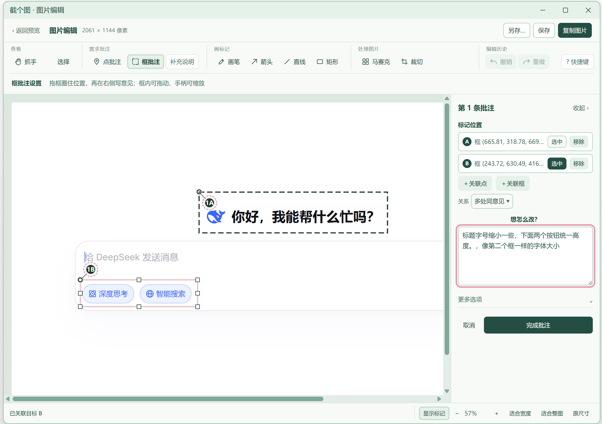
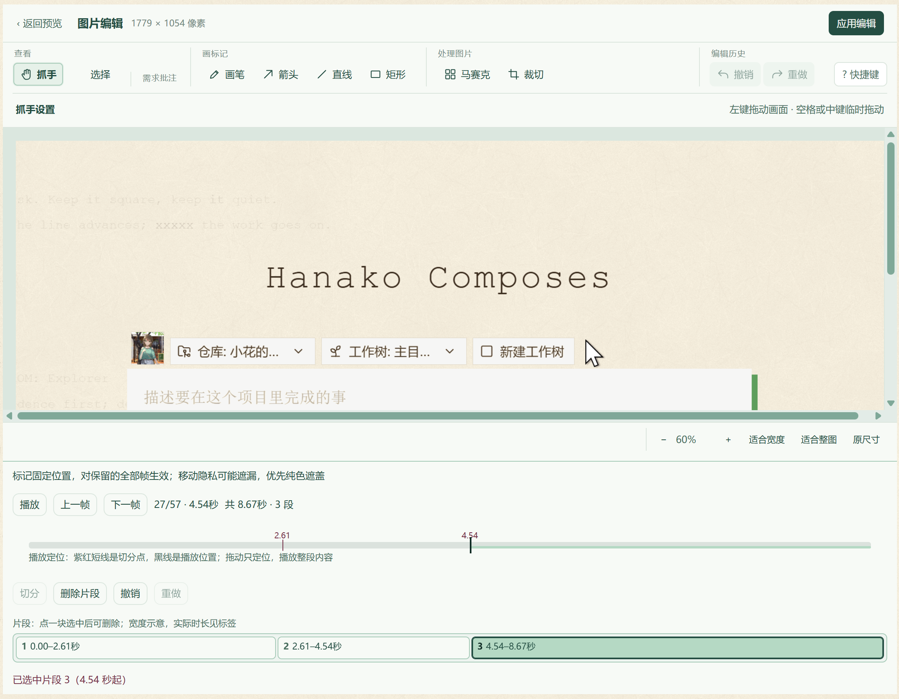

# 截个图

一个 Windows 桌面截图工具，支持普通截图、滚动长截图、图片批注，以及短 GIF 录制和基础编辑。

当前处于早期试用阶段。复杂壁纸、半透明界面和固定悬浮控件可能影响长截图拼接，请检查成图，不要把提示“不完整”的结果当作完整记录。

源码仓库 [moononnn/jiegetu](https://github.com/moononnn/jiegetu) ｜ 下载 [Releases](https://github.com/moononnn/jiegetu/releases)（安装包尚未发布） ｜ 反馈 [Issues](https://github.com/moononnn/jiegetu/issues)

## 功能预览

### 批注：圈出位置，写清要改什么

同一张图里框出 A、B 两个目标，关联成同一条批注，右侧写下需求文字，底部显示当前关联的目标。复制时编号和框留在编辑浮层，底图上只保留已经画上去的马赛克、遮盖和笔迹。

### GIF：在时间轴上切分片段

紫红短线是切分点，黑线是播放位置；下方列出各片段的起止时间，选中后可以单独删除。

两张演示图的底图都是第三方界面（含 Hana 工作台与 DeepSeek 的聊天页面），只用来展示本工具的画布和面板。截图里的产品、服务与本项目没有关联，本项目也不绑定或依赖它们。

## 可以做什么

- **普通截图**：框选、复制、保存、另存；F1 可在稳定的截图或编辑页面再截一层，退出后回到原图。
- **图片编辑**：画笔、矩形、直线、箭头、马赛克、纯色遮盖和画面裁切；矩形、线和箭头可二次调整。
- **需求批注**：点或框指定位置，附文字、关联目标、局部放大和可选的操作／当前／期望说明。复制为一张“原图＋批注说明”图片，不需要绑定特定 AI 或聊天软件。
- **滚动长截图**：在支持的单屏区域里滚动采集，完成后用普通窗口检查、编辑和输出；无法核实的部分保留警告。
- **GIF**：先框选，再点击录制；停止后预览。支持切分、删除多个片段、裁首尾、裁画面，以及整段固定位置的绘图和遮盖。
- **外观与窗口**：跟随 Windows／浅色／深色；编辑窗口可最小化、缩放和切换，不强制置顶。

## 下载与运行

面向 **Windows x64**。发布后从本仓库的 **Releases** 获取附件，GitHub 的“Download ZIP”仅包含源码，不是可以直接运行的软件。

| 下载形式 | 适合谁 | 数据行为 |
| --- | --- | --- |
| 安装版 `*-Setup-x64.exe` | 希望有卸载入口、长期使用 | 设置和日志保存在当前账户的 AppData |
| 免安装版 `*-Portable-x64.exe` | 不想安装，直接运行 | 同样使用 AppData；不是零落盘或设置随 U 盘迁移的模式 |

目前安装包仍在准备和验证中；没有附件时，请按[构建说明](docs/BUILDING.md)从源码运行。安装版和免安装版使用同一套数据与单实例锁，不应同时运行。

首发构建尚无代码签名，Windows 可能显示未知发布者或信誉提示。请核对下载来源和发布页的 SHA-256；不要为了运行软件关闭系统防护。

## 最短使用流程

1. 启动后程序驻留托盘。默认 **F1** 开始截图，也可左键托盘打开设置，或右键打开快捷菜单后选择“开始截图”。
2. 拖出区域，直接复制／保存，或进入编辑。输出按钮顺序为 **另存 → 保存 → 复制**。
3. 长图在框选后进入长截图，滚动采集后点击完成；先检查成图和警告，再输出。
4. 录 GIF 时先框选区域，再点击“录制 GIF”；停止后预览，需要时进入编辑。
5. 退出整个程序请用托盘菜单的“退出”；关闭设置窗口只会收回托盘。

### 修改快捷键

设置 → 快捷键 → **更改 → 按下新组合键 → 保存**。取消或按 Esc 不会更改原键。录入期间只暂停本应用原快捷键，不能替其它软件释放被占用的组合键。

### 编辑导航

- 滚轮：上下滚动；Shift＋滚轮：左右滚动。
- Ctrl＋滚轮：缩放。
- 空格＋左键拖动，或中键拖动：临时平移，不切换绘图工具。
- 裁切：默认全图选中，拖边角调整；Enter 确认，Esc 取消。

## 隐私和限制

- 不绑定聊天软件或 Agent，不自动发送截图。复制或保存后，发送给谁由你决定。
- 批注编号和框只显示在编辑浮层；复制时在下方列出坐标与说明，底图保留已应用的马赛克、遮盖和笔迹。
- 敏感内容优先使用纯色遮盖。GIF 遮盖对保留的全部帧固定生效，**不会自动跟踪移动目标**；导出前应播放检查整段。
- GIF 以短录制为主，当前目标 10 帧／秒、最多 30 秒，仅支持单屏选区，不录声音。接收软件是否能粘贴动图文件取决于它自身的支持。
- 长截图无法保证所有应用都能正确拼接；壁纸断层、浮动按钮重复、混合 DPI 与大图性能仍需持续验证。
- 日志用于本地排障，不自动上传。分享日志、截图或录制前请自行检查隐私。

## 开发与反馈

源码运行、原生组件及双版本打包见[构建说明](docs/BUILDING.md)。发布验证和当前门禁见[发布检查表](docs/RELEASE_CHECKLIST.md)。

反馈问题时尽量给出系统版本、显示缩放、操作步骤、预期与实际结果；截图和日志请先遮掉私人信息。测试通过不代表所有真实桌面场景都已验证。

## 许可

本软件按根目录 [LICENSE](LICENSE) 里的《截个图免费使用与禁止收费转售许可 1.0》提供。源码是公开的，但**不是 OSI 认可的开源许可**：允许免费使用和免费分发，对软件本身的收费销售、收费下载和收费授权另有限制。

- **可以免费使用**：个人、企业和其他组织都能用，包括在工作中使用、接单给客户截图，以及在收费产品、收费内容里使用本软件产出的截图和 GIF；不必付费，也不必额外署名。
- **可以修改和免费分享**：修改版可以自己用，也可以免费分发；分发时保留许可全文和版权声明，注明为修改版，不得冒充官方版本。
- **产出使用不另设限制**：许可不限制这些产出的商业用途，也不因此要求署名；画面里第三方内容本身的版权不在这份许可范围内。
- **禁止收费转售软件**：不得对软件或修改版收费销售、收费下载、收费授权；需要这类授权，请先取得版权持有人的书面同意。
- **按现状提供**：不附带担保，责任在适用法律允许的范围内限制；违反上述限制时授权自动终止。

第三方组件按各自许可提供，见 [THIRD-PARTY-NOTICES.md](THIRD-PARTY-NOTICES.md)。三个在用图标使用 GPT 自行生成，适用条款尚未核实；来源和核查状态见[图标记录](assets/LICENSE.txt)。安装包也仍在准备和验证中，当前目录不是已发布的正式版本。
